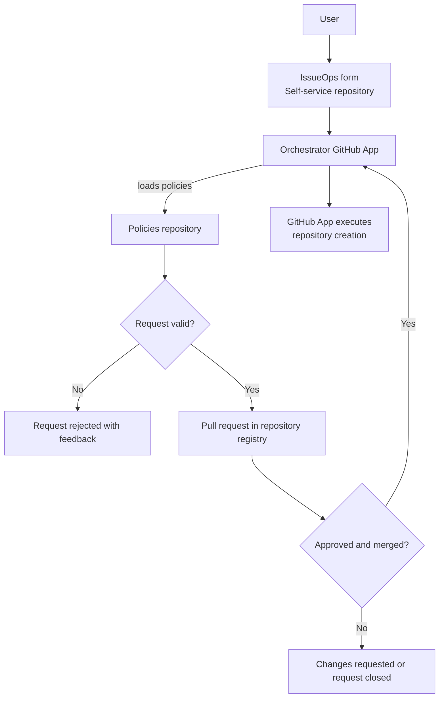
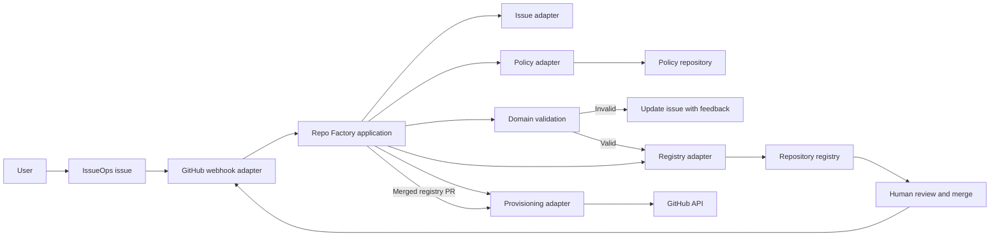

# Repo Factory

Repo Factory is a self-service architecture for creating new GitHub repositories in a controlled and auditable way.

It separates the request experience, policy enforcement, approval flow, and final repository creation into distinct components so the process stays consistent across the organization.

## Architecture

The system is built around four repositories and one orchestrator:

1. Self-service repository (this repository)
    - This is the entry point for users.
    - Hosts the IssueOps form used to submit repository creation requests.
	- A user opens an issue and provides the repository name, description, owning team, and visibility (`public` or `private`).
	- The issue acts as the source of truth for the request.

2. Policies repository
	- Stores the organization-wide rules that govern repository creation.
	- Typical policies include naming conventions, allowed visibility levels, required teams, default labels, branch protection rules, and ownership constraints.
	- Defines the repository metadata schema used by the repository registry.
	- The orchestrator reads these rules before it allows a request to proceed.

3. Repository registry
	- Stores a repository metadata record for every repository created through the factory.
	- It works as a traceability layer for the organization.
	- Each request is reviewed and merged in the repository registry before the repository is created.

	Example repository metadata:

	```yaml
	policy_configuration_version: "1.0.0"
	repository_creation_request: "https://github.com/your-org/self-service/issues/123"
	repository:
	  name: payments-api
	  description: API for processing payments
	  visibility: private
	ownership:
	  team: payments-platform
	```

4. Orchestrator GitHub App (backend)
	- This is the automation layer that coordinates the whole flow.
	- It listens for issues opened in the self-service repository.
	- It validates the request against the policies repository.
	- It opens a pull request in the repository registry for approval.
	- Once the pull request is approved and merged there, the GitHub App executes the repository creation and applies the agreed configuration.

## Flow



## Architecture Boundaries



## Request Lifecycle

1. A user opens an issue in the self-service repository using the IssueOps form.
2. The orchestrator receives the event and loads the applicable policies.
3. The request is validated against organizational rules.
4. If the request passes validation, the orchestrator creates a pull request in the repository registry.
5. After review and approval in the repository registry, the pull request is merged.
6. The GitHub App executes the new GitHub repository creation.

## Why This Design Works

- Separation of concerns: requests, policy, audit data, and automation are isolated.
- Governance: repository creation is constrained by policies before anything is provisioned.
- Auditability: every request and every created repository can be traced.
- Reviewability: the repository registry pull request adds a human approval checkpoint before creation.
- Efficiency: standard, low-risk requests can be auto-approved, while manual review is reserved for exceptions.
- Extensibility: new policy checks or repository defaults can be added without changing the user-facing request flow.

## Risks and Mitigations

- Risk: fragmented request history across multiple systems can make governance and auditing harder.
	Mitigation: make the repository registry the single approval record and source of truth for request state. Store the issue link, policy version, approval decision, and final repository name there so every step is traceable from one place.

- Risk: policy-version mismatch between validation and provisioning can create inconsistent outcomes.
	Mitigation: pin and record the exact policy version at validation time, then enforce that same version through approval, merge, and repository creation.

- Risk: ambiguous lifecycle transitions can lead to brittle retries and hard-to-recover failures.
	Mitigation: add a formal request state machine with explicit states such as requested, validated, pending_approval, approved, provisioning, created, and failed.

- Risk: duplicate events from webhooks or PR workflows can create duplicate repositories or partial provisioning.
	Mitigation: design the GitHub App to be idempotent so webhook handling, PR merge processing, and provisioning steps are all safe to retry.

## Example Outcome

When a team member wants a new repository, they do not create it manually. They submit the IssueOps form in the self-service repository, the orchestrator checks the request against policy, the repository registry handles the approval and merge flow, and the GitHub App creates the repository only after the request is approved and merged. Standard, low-risk requests can bypass manual review and be auto-approved by policy.

This gives the organization a repeatable factory for repository creation instead of an ad hoc manual process.