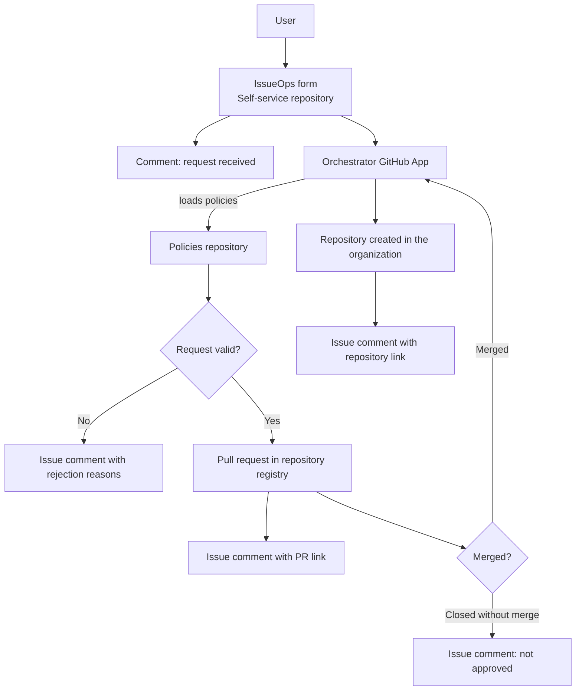
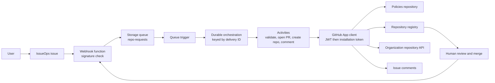

# Repo Factory

Repo Factory is a self-service architecture for creating new GitHub repositories in a controlled and auditable way.

It separates the request experience, policy enforcement, approval flow, and final repository creation into distinct components so the process stays consistent across the organization.

## Architecture

The system is built around five repositories. All of them live in the same GitHub **organization** (currently `scriptkloud`). Repositories are created through an organization endpoint, which GitHub does not allow for GitHub App tokens on personal accounts.

| Repository | Role |
|---|---|
| `repo-factory` (this repository) | Self-service entry point: the Issue Form and this documentation |
| `repo-factory-policies` | The rules every request is validated against |
| `repo-factory-registry` | Approval record: one metadata file per repository, added through a pull request |
| `repo-factory-app` | The orchestrator: an Azure Function App (Python 3.12, Flex Consumption) acting as a GitHub App |
| `repo-factory-infra` | Terraform for the Azure resources and the GitHub Actions workflow that deploys them |

1. Self-service repository (this repository)
	- Hosts the Issue Form at `.github/ISSUE_TEMPLATE/repository-request.yml`.
	- A user opens an issue and provides the repository name, description, owning team (for example `team-payments`), and visibility (`public` or `private`).
	- The form applies the `repository-request` label automatically. The label must exist in this repository, and the form must be on the default branch.
	- The issue is the user-facing source of truth for the request. The orchestrator reports each status change on it as a comment.

2. Policies repository
	- Stores `repository-creation-policy.yml`, which the orchestrator reads on every request and again before creation.
	- Policy version `v1.0.0` enforces:
		- repository name: lowercase, 2 to 63 characters, matching `^[a-z0-9][a-z0-9-]{1,62}$`
		- visibility: `public` or `private`
		- description: required, at most 200 characters
		- owning team: required, matching `^team-[a-z0-9][a-z0-9-]*$`

3. Repository registry
	- Holds `repositories/<name>.yml` for every approved repository, plus `schemas/repository-metadata.schema.json`, which the records must follow.
	- Each request arrives as a pull request on the branch `repo-request/<name>-issue-<n>`. The merge is the approval.
	- The record keeps the submitted request, so it stays traceable.

	Example record:

	```yaml
	name: payments-api
	description: API for processing payments
	visibility: private
	owning_team: team-payments
	default_branch: main
	request_issue: 123
	requester: octocat
	```

4. Orchestrator GitHub App (`repo-factory-app`)
	- Receives GitHub webhooks for **Issues** and **Pull requests** events and verifies their signature.
	- Queues each accepted event, then processes it in a durable orchestration. The orchestration is keyed by the webhook delivery ID, so repeated deliveries are not processed twice.
	- Validates the request against the policies repository and opens the registry pull request.
	- After the registry pull request is merged, it re-checks the record against the policy, creates the repository in the organization, and comments the result on the issue.
	- The GitHub App needs these permissions, installed on all three GitHub repositories (and on the organization, to create repositories):
		- Contents: read-only on policies, read and write on the registry
		- Pull requests: read and write on the registry
		- Issues: read and write on this repository
		- Administration: read and write (repository creation)

5. Infrastructure (`repo-factory-infra`)
	- Terraform creates the resource group, storage account, Application Insights and the Function App.
	- App settings include `GITHUB_APP_ID`, `GITHUB_OWNER`, `POLICY_REPOSITORY` and `REGISTRY_REPOSITORY`. The GitHub App private key and the webhook secret are Key Vault references.
	- A GitHub Actions workflow runs Terraform on a self-hosted runner. Azure access uses OpenID Connect, so the Entra app registration needs a federated credential for this organization's repository and environment.

## Flow



## Architecture Boundaries



## Request Lifecycle

1. A user opens an issue in the self-service repository using the IssueOps form. The orchestrator comments that the request was received and is being validated.
2. The orchestrator loads the policy from the policies repository and validates the request. It also rejects names that already exist as a repository or in the registry.
3. If validation fails, the issue gets a comment listing every violation. The user edits the issue to correct it, which sends the request through validation again.
4. If it passes, the orchestrator opens a pull request in the registry that adds `repositories/<name>.yml`, and comments the link on the issue. A retry reuses an open pull request instead of opening a second one.
5. A reviewer approves and merges the pull request. If it is closed without merging, the issue is told that the request was not approved and nothing is created.
6. On merge, the orchestrator re-validates the merged record, creates the repository in the organization, and comments the approval and the repository link on the issue.
7. If creation fails after three attempts, the issue gets a comment saying the request was approved but creation failed, and an administrator has to look into it.

Only merged pull requests from `repo-request/<name>-issue-<n>` branches in the registry trigger creation. Other pull requests are ignored.

## Why This Design Works

- Separation of concerns: requests, policy, audit data, and automation are isolated.
- Governance: repository creation is constrained by policies before anything is provisioned.
- Auditability: every request and every created repository can be traced.
- Reviewability: the repository registry pull request adds a human approval checkpoint before creation.
- Extensibility: new policy checks or repository defaults can be added without changing the user-facing request flow.

## Setup Notes

- **Organization:** repository creation only works in an organization. Install the GitHub App on the organization with access to all repositories, and accept the Administration permission as an owner.
- **Webhook:** point the app's webhook at `https://<function-app>.azurewebsites.net/api/webhook?code=<function key>`. Use the real webhook secret, which is the value stored in Key Vault, and subscribe to **Issues** and **Pull requests** events.
- **Deploy:** apply the Terraform in `repo-factory-infra`, then publish the code with `func azure functionapp publish repo-factory-func-app --python` from `repo-factory-app`.
- **Troubleshooting:** check the webhook's recent deliveries in the GitHub App settings, then the exceptions in Application Insights. A 403 or 404 from GitHub points to the app's permissions or installation scope. A message in the `repo-requests-poison` queue means the worker could not read it.

## Risks and Mitigations

- Risk: fragmented request history across multiple systems can make governance and auditing harder.
	Mitigation: the registry holds the approved record, and the issue holds the conversation. Each registry record links back to its issue number. The policy version is currently only noted in the pull request body, and recording it in the registry record is still to do.

- Risk: policy changes between validation and provisioning can create inconsistent outcomes.
	Mitigation: the policy is re-checked against the merged record at creation time, so a request that no longer satisfies the policy is refused. Pinning the exact policy version through the whole flow is still to do.

- Risk: ambiguous lifecycle transitions can lead to brittle retries and hard-to-recover failures.
	Mitigation: the lifecycle is handled by a durable orchestration with retries, and every outcome is reported on the issue. A formal state machine with explicit states is still to do.

- Risk: duplicate events from webhooks or PR workflows can create duplicate repositories or partial provisioning.
	Mitigation: orchestrations are keyed by the webhook delivery ID, an existing registry PR or repository is reused rather than recreated, and creation skips a repository that already exists. Two separate requests for the same name are rejected by the existing-name checks.

## Not Yet Implemented

- Automatic approval of low-risk requests. Every request currently needs a human to merge the registry pull request.
- Applying default labels or branch protection after creation. Only the repository itself is created, with the name, description and visibility from the record.
- Granting the owning team access to the new repository.

## Example Outcome

When a team member wants a new repository, they do not create it manually. They submit the IssueOps form in the self-service repository, the orchestrator checks the request against policy, the repository registry handles the approval and merge flow, and the GitHub App creates the repository only after the request is approved and merged. The requester follows each step in comments on the issue.

This gives the organization a repeatable factory for repository creation instead of an ad hoc manual process.