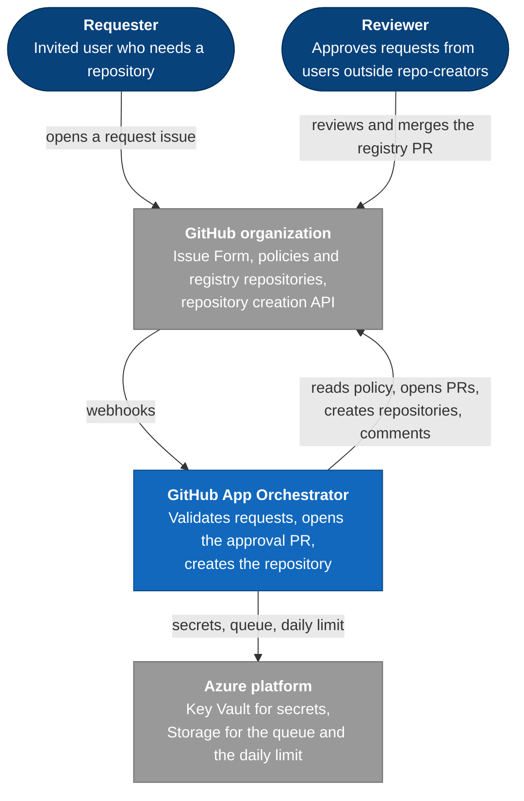
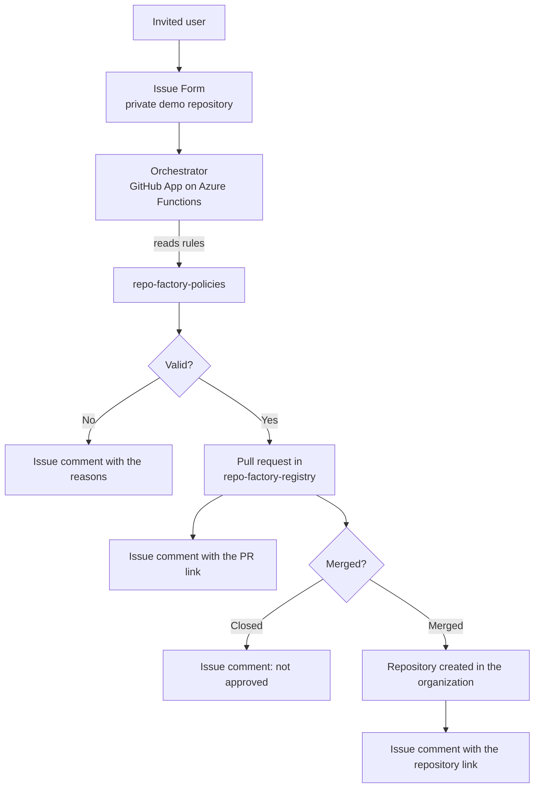
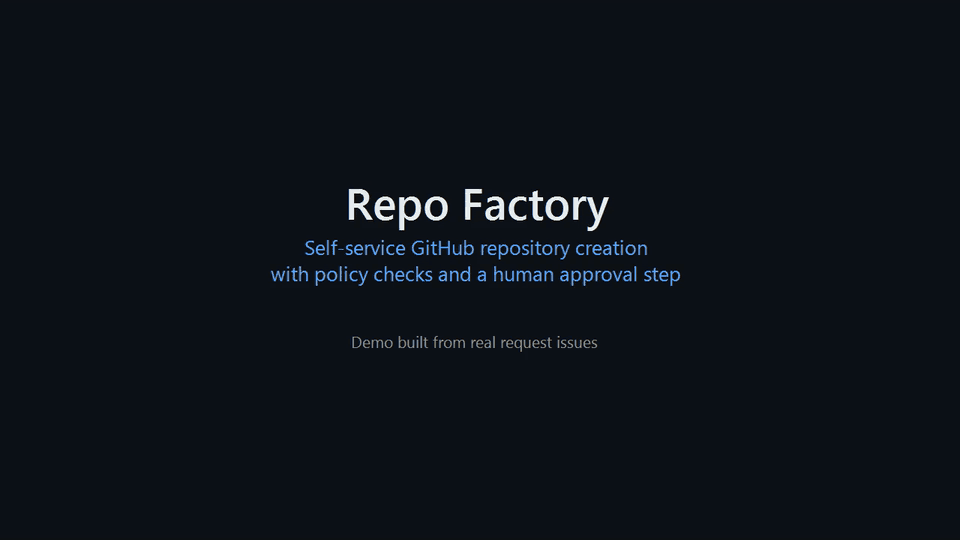

# Repo Factory

Self-service GitHub repository creation, with policy checks and a human approval step. A user fills in an issue form. The system validates the request, opens a pull request for approval, and creates the repository once that pull request is merged. Each step is reported back on the issue.

**Stack:** GitHub Apps, Azure Functions (Python), Durable Functions, Azure Storage Queues, Key Vault, Terraform, GitHub Actions.

## System context



## How it works



1. **Request.** The user opens an issue with the repository name, description, owning team and visibility. The bot replies that the request is being validated.
2. **Validate.** The orchestrator checks the request against the policy file, rejects names that already exist, and verifies that the owning team exists in the GitHub organization. Violations are listed in a comment, and editing the issue triggers a new check.
3. **Approve.** A valid request becomes a pull request in the registry that adds `repositories/<name>.yml`. Requests from members of the `repo-creators` team are merged automatically. For everyone else, a reviewer merges it. Either way, the merge is the approval.
4. **Create.** On merge, the orchestrator checks the record against the policy again, creates the repository, and comments the link on the issue.

## Demo



Built from real request issues: automatic approval for a trusted requester, a manual review that is rejected, and the daily request limit.

## Try it

This repository is the public showcase. The live Issue Form runs in a private demo repository, so that only invited people can send requests to the service. To try it, ask for access to `repo-factory-demo`, open an issue with the form and watch the bot reply.

## Repositories

| Repository | Role |
|---|---|
| `repo-factory` | Public showcase: this documentation |
| `repo-factory-demo` (private) | Entry point: the Issue Form, open to invited users only |
| `repo-factory-policies` | The rules every request is checked against |
| `repo-factory-registry` | Approval record: one metadata file per repository |
| `repo-factory-app` | The orchestrator, an Azure Function App acting as a GitHub App |
| `repo-factory-infra` | Terraform for the Azure resources and the deploy workflow |

> **Source code access.** `repo-factory-app` and `repo-factory-infra` are private because they hold deployment configuration for a live environment. They are available on request, and I am happy to walk through the code in an interview.

A registry record looks like this:

```yaml
name: payments-api
description: API for processing payments
visibility: private
owning_team: team-payments
default_branch: main
request_issue: 123
requester: octocat
```

## Design decisions

- **Approval through a pull request.** Review, audit trail and permissions come from GitHub itself, so there is no custom approval system to build.
- **Trust-based approval.** Members of the `repo-creators` team skip the manual review, and all other requests wait for a reviewer. Any failure while checking or merging falls back to manual review, never to approval.
- **Policy as a separate repository.** Rules change without redeploying the app, and the same rules are applied again at creation time.
- **Queue, then durable orchestration.** The webhook only verifies the signature and enqueues, so GitHub gets a fast answer. The orchestration is keyed by the webhook delivery ID, so repeated deliveries are not processed twice.
- **Safe to retry.** An existing registry pull request or repository is reused instead of duplicated, and activities retry before the requester is told that creation failed.
- **The requester is never left guessing.** Every outcome appears as a comment on their issue.
- **Abuse protection.** The form lives in a private repository, so only invited users can reach the service. As a second layer, it accepts one request per day. The slot is claimed with an atomic table insert, and refused requests are told when to retry.
- **Secrets in Key Vault.** The GitHub App key and the webhook secret are Key Vault references, and Azure access from CI uses OpenID Connect with no stored credentials.

## Roadmap

- Apply default labels and branch protection to new repositories.
- Grant the owning team access to the repository it owns.
